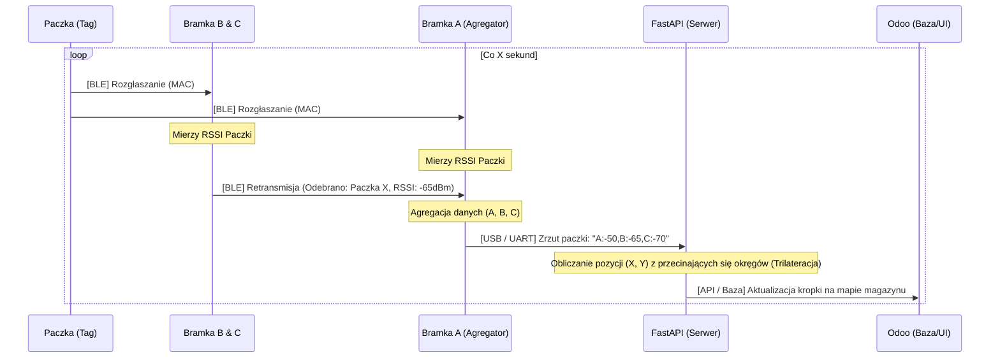
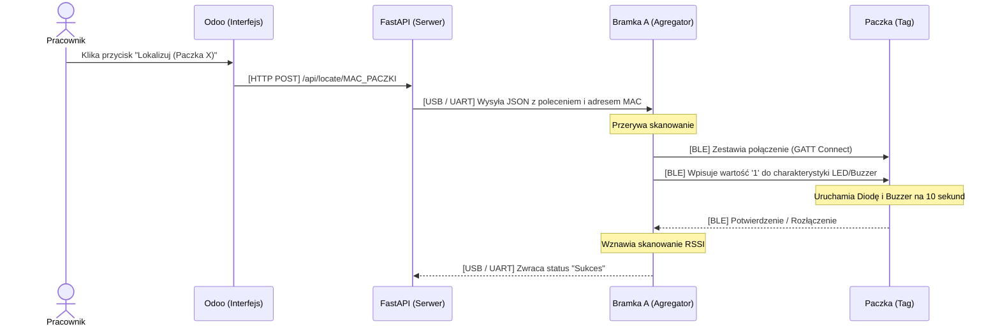

Smart Lokalizator Paczek - System IoT
Opis Projektu
System lokalizacji paczek w magazynie punktu odbioru, wykorzystujący technologię Bluetooth Low Energy (BLE) oraz urządzenia IoT. Celem projektu jest drastyczne skrócenie czasu poszukiwania przesyłek przez pracowników. System opiera się na doczepianych do paczek modułach wielokrotnego użytku, które na żądanie emitują sygnał świetlny i dźwiękowy, a także na ciągłym szacowaniu ich położenia za pomocą trylateracji sygnału RSSI.
Architektura Systemu
Rozwiązanie składa się z czterech głównych warstw komunikujących się w lokalnej sieci sklepu:
Aplikacja kliencka (Frontend): Natywny interfejs Odoo dostępny przez przeglądarkę mobilną dla pracowników magazynu.
Serwer centralny (Backend): Python (FastAPI) odpowiadający za API, logikę biznesową, obliczenia przestrzenne (NumPy) oraz komunikację szeregową (Serial) z bramką główną.
Bramki (Gateways): Trzy urządzenia oparte na Seeed XIAO nRF52840 z bezprzewodową siecią Bluetooth LE, w tym jedna bramka główna podłączona na stałe kablem USB do serwera.
Lokalizatory (Hardware): Autorskie urządzenia oparte na Seeed XIAO nRF52840, zasilane akumulatorem LiPo, wyposażone w diodę LED o wysokiej jasności i pasywny brzęczyk piezo.
Struktura Repozytorium
```text
Smart-lokalizator-paczek/
├── odoo_module/              # Niestandardowy moduł Odoo (UI, przyciski, statusy)
├── backend/                  # Serwer API i logika trylateracji (Python/FastAPI)
│   ├── api/                  # Endpointy REST (rutery)
│   ├── core/                 # Algorytmy trylateracji, logika komunikacji Serial/UART
│   ├── models/               # Modele danych i schematy bazy
│   ├── requirements.txt      # Zależności backendowe (FastAPI, NumPy, pyserial, itp.)
│   └── main.py               # Plik startowy serwera
├── firmware/                 # Oprogramowanie wbudowane (C++/Arduino)
│   ├── gateway/              # Kod dla bramek XIAO nRF52840 (Skanery BLE i Agregator)
│   └── locator/              # Kod dla modułów XIAO nRF52840 (GATT Server, obsługa GPIO)
├── hardware/                 # Projekty sprzętowe
│   ├── 3d_models/            # Skrypty OpenSCAD i wygenerowane pliki STL (obudowy, klipsy)
│   └── schematics/           # Schematy elektroniczne i diagramy podłączeń
├── docs/                     # Dokumentacja projektu (diagramy sekwencji, analiza wymagań)
├── docker-compose.yml        # Konfiguracja środowiska (PostgreSQL, Redis, Backend)
└── README.md                 # Główny plik informacyjny
```
Stos Technologiczny
Frontend: Moduł Odoo wraz z odpowiednimi rozszerzeniami
Backend: Python, FastAPI, NumPy (obliczenia przestrzenne), PySerial (komunikacja przewodowa)
Bazy danych: PostgreSQL (dane relacyjne, historia), Redis (cache danych telemetrycznych RSSI)
Urządzenia IoT: Seeed XIAO nRF52840 (C++)
Protokoły komunikacyjne: REST API, USB/UART (Serial), Bluetooth Low Energy (BLE 5)
Architektura i Przepływ Danych
Projekt wykorzystuje hybrydową architekturę Edge Computing połączoną z protokołem BLE (Bluetooth Low Energy) oraz backendem w FastAPI i systemem ERP Odoo.
Topologia Sprzętowa
W systemie pracują 4 mikrokontrolery Seeed XIAO nRF52840, z których każdy pełni ściśle określoną rolę:
Paczka (Tag BLE): Zasilana bateryjnie. Cyklicznie rozgłasza swój adres MAC (Beacon) i czeka na połączenie GATT, by uruchomić diodę/buzzer.
Bramki Satelitarne (Bramka B i C): Zasilane z gniazdek ściennych. Zawieszone w rogach magazynu. Ich jedynym zadaniem jest nasłuch (skanowanie RSSI Paczki) i retransmisja wyników przez BLE.
Bramka Główna (Agregator / Bramka A): Wpięta kablem USB do nieruchomego serwera (laptopa). Skanuje eter, zbiera odczyty od siebie oraz z Bramek B i C, a następnie przesyła je kablem (Serial/UART) do backendu.
---
Przepływ 1: Ciągłe Śledzenie Pozycji (Trilateracja w Tle)
Proces ten działa nieprzerwanie w tle, aktualizując pozycję paczki bez udziału użytkownika.

---
Przepływ 2: Akcja "Lokalizuj" (Wywołanie Wizualne i Dźwiękowe)
Proces inicjowany przez pracownika magazynu za pomocą interfejsu systemu Odoo.

