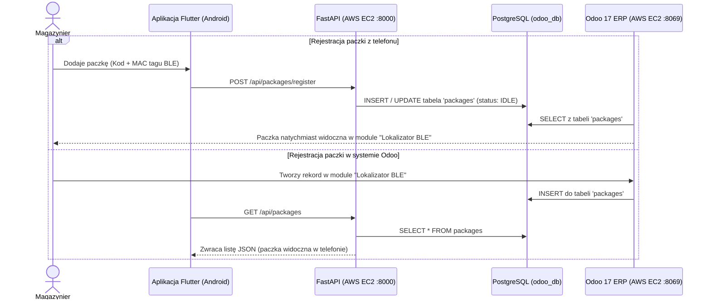
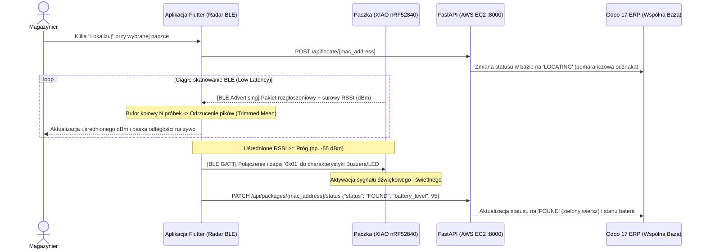
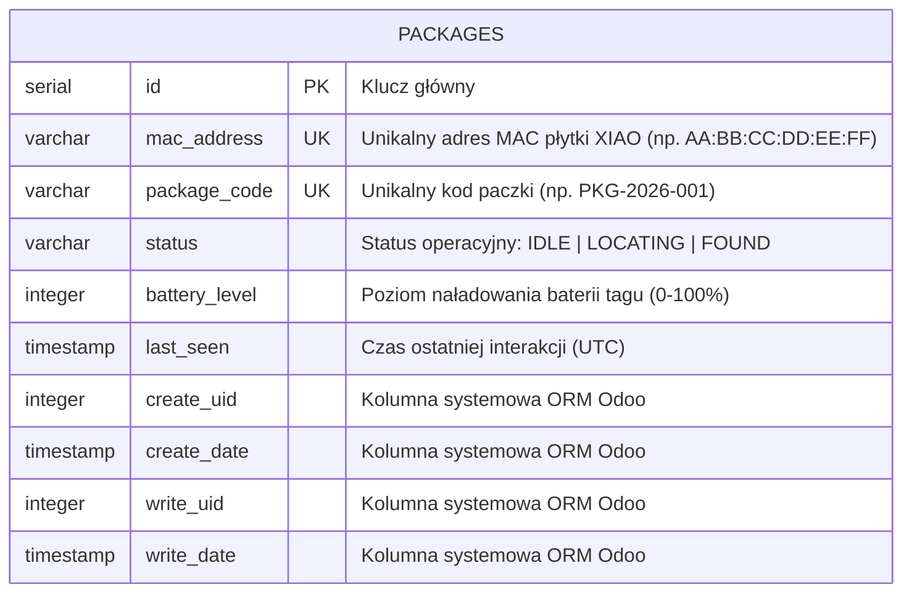

# Smart Lokalizator Paczek - System IoT & Cloud ERP

## Opis Projektu
System lokalizacji paczek w magazynie oraz punkcie odbioru, łączący technologię **Bluetooth Low Energy (BLE)**, przetwarzanie brzegowe na smartfonie (**Edge Computing**) oraz chmurowy system klasy ERP (**Odoo 17**). 

Celem projektu jest drastyczne skrócenie czasu poszukiwania przesyłek przez pracowników magazynu. System opiera się na doczepianych do paczek modułach wielokrotnego użytku (**Seeed Studio XIAO nRF52840**) oraz aplikacji mobilnej **Flutter (Android)**, która pełni rolę mobilnego radaru RSSI z zaawansowaną filtracją zjawiska wielodrogowości i automatycznym wyzwalaniem sygnału świetlno-dźwiękowego (GATT).

---

## Architektura Systemu
Rozwiązanie składa się z czterech głównych warstw zintegrowanych wokół wspólnej bazy danych w chmurze **AWS EC2**:

1. **System ERP (Web Frontend & WMS):** Dedykowany moduł `smart_parcel_locator` w systemie **Odoo 17**, umożliwiający pracownikom podgląd statusów paczek w czasie rzeczywistym (`IDLE`, `LOCATING`, `FOUND`), poziomu baterii tagów oraz rejestrację przesyłek.
2. **Aplikacja Mobilna (Edge Computing & BLE Radar):** Aplikacja **Flutter** na system Android. Odpowiada za ciągłe skanowanie pasma BLE, odfiltrowywanie zakłóceń i odbić sygnału za pomocą algorytmu **średniej kroczącej obciętej (Trimmed Moving Average)**, wizualizację odległości oraz automatyczne wyzwalanie buzzera/LED na paczce po przekroczeniu progu mocy sygnału RSSI.
3. **Serwer Centralny (Cloud Backend API):** Asynchroniczny serwer **Python (FastAPI + SQLAlchemy/asyncpg)** uruchomiony w kontenerze Docker na instancji **AWS EC2** (`63.187.131.29`), wystawiający punkty końcowe REST API dla aplikacji mobilnej.
4. **Lokalizatory IoT (Hardware):** Autorskie tagi oparte na mikrokontrolerze **Seeed Studio XIAO nRF52840**, zasilane akumulatorem Li-Ion/LiPo ($3.7\text{ V}$), wyposażone w sygnalizację LED oraz brzęczyk (buzzer) wyzwalany przez usługę GATT.

---

## Struktura Repozytorium

```text
Smart-lokalizator-paczek/
├── addons/
│   └── smart_parcel_locator/     # Niestandardowy moduł Odoo 17 (WMS / Lokalizator BLE)
│       ├── security/             # Uprawnienia dostępu (ir.model.access.csv)
│       ├── __init__.py           # Inicjalizacja pakietu Python
│       ├── __manifest__.py       # Definicja i konfiguracja modułu Odoo
│       ├── models.py             # Model ORM (smart.parcel) zmapowany na tabelę 'packages'
│       └── views.xml             # Widoki tabeli (Tree), formularzy (Form) i odznak statusów
├── backend/                      # Serwer REST API (Python / FastAPI)
│   ├── Dockerfile                # Obraz kontenera backendu
│   ├── requirements.txt          # Zależności (FastAPI, Uvicorn, SQLAlchemy, asyncpg)
│   └── main.py                   # Logika API i integracja ze wspólną bazą PostgreSQL
├── smart_locator_app/            # Aplikacja mobilna Android (Flutter / Dart)
│   ├── android/                  # Konfiguracja natywna Android (uprawnienia BLE, Cleartext HTTP)
│   ├── lib/
│   │   └── main.dart             # Interfejs, klient REST API, skaner BLE i filtr wielodrogowości
│   └── pubspec.yaml              # Zależności Flutter (http, flutter_blue_plus, permission_handler)
├── firmware/                     # Oprogramowanie wbudowane dla Seeed XIAO nRF52840 (C++ / Arduino)
│   └── locator/                  # Kod tagu na paczce (BLE Advertising + Serwer GATT dla Buzzera/LED)
├── hardware/                     # Projekty sprzętowe
│   ├── 3d_models/                # Modele obudów (STL / OpenSCAD)
│   └── schematics/               # Schematy elektroniczne i projekty PCB (EasyEDA)
├── docker-compose.yml            # Definicja ujednoliconego stosu (odoo_postgres, odoo_erp, locator_fastapi)
├── INTEGRATION_GUIDE.md          # Specyfikacja techniczna API oraz protokołu BLE GATT
└── README.md                     # Główna dokumentacja projektu
```

---

## Stos Technologiczny
- **Aplikacja mobilna:** Flutter (Dart), `flutter_blue_plus` (BLE Low Latency Scanner & GATT Client), `http`, `permission_handler`
- **System ERP:** Odoo 17.0 (moduł `smart_parcel_locator` zintegrowany na poziomie ORM)
- **Backend API:** Python 3.11, FastAPI, SQLAlchemy 2.0 (Async), `asyncpg`
- **Baza danych:** PostgreSQL 15 (pojedyncza, współdzielona baza `odoo_db` dla Odoo i FastAPI)
- **Infrastruktura i DevOps:** AWS EC2 (`t3.small`, Ubuntu 22.04 LTS, Elastic IP: `63.187.131.29`), Docker & Docker Compose
- **Urządzenia IoT:** Seeed Studio XIAO nRF52840 (Bluetooth Low Energy 5.0)

---

## Architektura i Przepływ Danych

W projekcie zastosowano podejście **Edge Computing**: zamiast przesyłać na serwer setki surowych pomiarów RSSI na minutę, cała obróbka sygnału radiowego oraz filtracja szumów odbywa się bezpośrednio na procesorze smartfona pracownika. Serwer w chmurze AWS otrzymuje wyłącznie zatwierdzone zdarzenia biznesowe (rejestracja paczki, rozpoczęcie poszukiwań `LOCATING`, odnalezienie paczki `FOUND` wraz z odczytem baterii).

### Filtracja wielodrogowości (Trimmed Moving Average)
W warunkach magazynowych fale radiowe $2.4\text{ GHz}$ ulegają odbiciom od metalowych regałów i ścian (zjawisko wielodrogowości – *multipath propagation*), co powoduje chwilowe, fałszywe skoki mocy sygnału. Aplikacja mobilna gromadzi ostatnie $N$ próbek RSSI w buforze kołowym (domyślnie $N = 10$, zakres $3 \le N \le 30$), sortuje je rosnąco, **odrzuca skrajną wartość minimalną oraz maksymalną (pik)**, a z pozostałych $N - 2$ elementów wylicza średnią arytmetyczną:

$$\overline{\text{RSSI}}_{\text{trimmed}} = \frac{1}{N - 2} \sum_{i=2}^{N-1} \text{RSSI}_{(i)}$$

---

### Przepływ 1: Rejestracja i Synchronizacja Paczek (Dwukierunkowa)

Zarówno moduł Odoo (`_table = 'packages'`), jak i serwer FastAPI (`__tablename__ = 'packages'`) operują bezpośrednio na tej samej tabeli w bazie `odoo_db`.



---

### Przepływ 2: Akcja "Lokalizuj", Radar RSSI i Wyzwolenie Lokalizatora

Proces poszukiwania przesyłki w magazynie z użyciem telefonu oraz tagu BLE na paczce.



---

## Schemat Bazy Danych (PostgreSQL – `odoo_db`)

Dzięki unifikacji architektury zrezygnowano z osobnej bazy telemetrycznej na rzecz jednej bazy **`odoo_db`** w kontenerze `odoo_postgres`. Model Odoo `smart.parcel` oraz model SQLAlchemy `Package` współdzielą tabelę **`packages`**.



---

## Endpointy REST API (FastAPI – port $8000$)

| Metoda | Endpoint | Opis działania |
|---|---|---|
| `GET` | `/api/packages` | Pobiera listę wszystkich zarejestrowanych paczek (posortowaną od najnowszych). |
| `POST` | `/api/packages/register` | Rejestruje nową paczkę lub aktualizuje istniejącą (`package_code`, `mac_address`) ze statusem `IDLE`. |
| `POST` | `/api/locate/{mac_address}` | Zmienia status wskazanej paczki na `LOCATING` w momencie uruchomienia radaru na telefonie. |
| `PATCH` | `/api/packages/{mac_address}/status` | Aktualizuje status paczki (np. na `FOUND` lub `IDLE`) oraz opcjonalnie zapisuje poziom baterii `battery_level`. |

---

## Specyfikacja BLE GATT (Integracja z Seeed XIAO nRF52840)

Aby płytka XIAO nRF52840 współpracowała z aplikacją mobilną Flutter:
1. Układ musi cyklicznie rozgłaszać pakiety **BLE Advertising** (w trybie *Connectable*, ze stałym adresem MAC zgodnym z wpisem w Odoo).
2. Po przekroczeniu progu RSSI aplikacja nawiązuje połączenie GATT i wysyła bajt `0x01` do charakterystyki wyzwalacza:
   - **Service UUID:** `19b10000-e8f2-537e-4f6c-d104768a1214`
   - **Buzzer/LED Characteristic UUID:** `19b10001-e8f2-537e-4f6c-d104768a1214` (`Write` / `Write Without Response`)
   - **Battery Characteristic UUID (opcjonalnie):** `19b10002-e8f2-537e-4f6c-d104768a1214` (`Read`, $1\text{ bajt}$ $0 - 100\%$)

Szczegółowa dokumentacja protokołu BLE oraz przykładowy kod integracyjny znajdują się w pliku [`INTEGRATION_GUIDE.md`](./INTEGRATION_GUIDE.md).

---

## Instrukcja Wdrożenia i Uruchomienia

### 1. Serwer Chmurowy (AWS EC2 – Docker Compose)
```bash
cd ~/Smart-lokalizator-paczek
git checkout rbronka
git pull origin rbronka

# Uruchomienie bazy PostgreSQL, systemu Odoo 17 oraz serwera FastAPI
docker compose up -d --build

# Pierwsza instalacja modułu 'smart_parcel_locator' w bazie odoo_db
docker exec -it odoo_erp odoo --db_host=db-odoo -r odoo -w odoopassword -d odoo_db -i smart_parcel_locator --stop-after-init --no-http
docker restart odoo_erp
```
- **Panel ERP Odoo 17:** `http://63.187.131.29:8069` (login: `admin`, hasło: `admin`)
- **Dokumentacja Swagger FastAPI:** `http://63.187.131.29:8000/docs`

### 2. Aplikacja Mobilna (Flutter – Android)
```powershell
cd smart_locator_app
flutter pub get
flutter run --release
```
